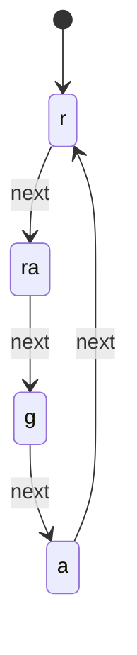

# One-way without controller — R1–R8

- `:r`, `:ra`, `:g`, `:a` stand for red, red+amber, green and amber.
- This configuration has no `:run`/`:halt` controller; every legal colour transition uses `:next`.
