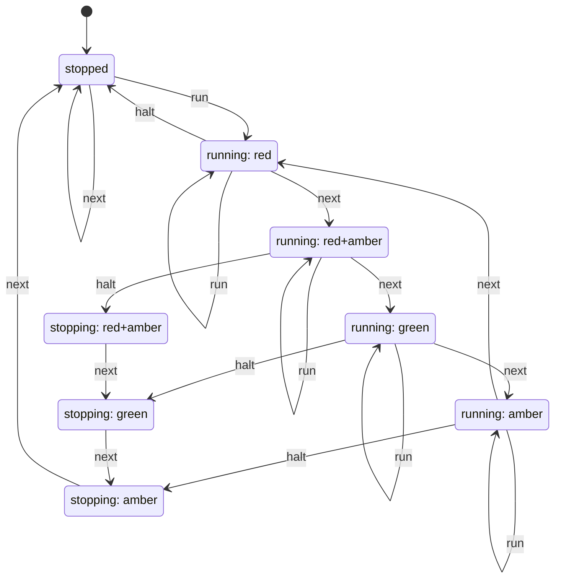

# One-way with controller — R1–R10

- `:run` changes controller mode while retaining red; `:halt` changes mode without changing lamp colour.
- Once halting is requested, legal `:next` events complete the remaining display cycle to red.
- Running-state `:run` loops depict internal, colour-preserving transitions; `:next` while stopped leaves the signal red.
