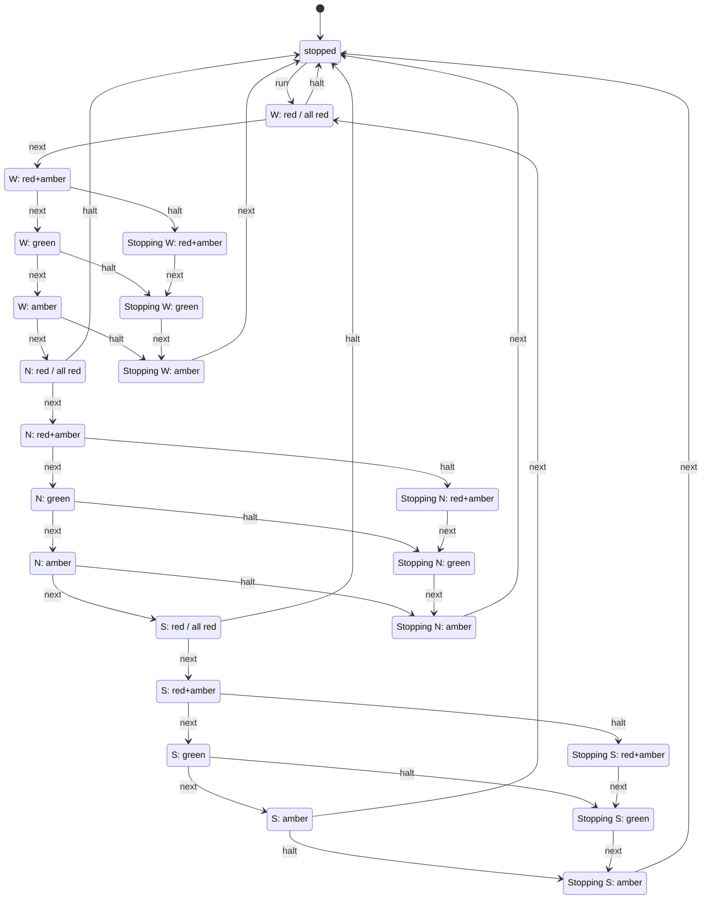

# Three-way traffic lights — R1–R10

- Only the currently selected approach is permitted to show `:ra`, `:g`, or `:a`; others remain red.
- Round-robin `:w` → `:n` → `:s` gives each approach a green phase every twelve `:next` events.
- The stopping subcharts preserve the current colour on `:halt` and return to all-red via `:next`.
